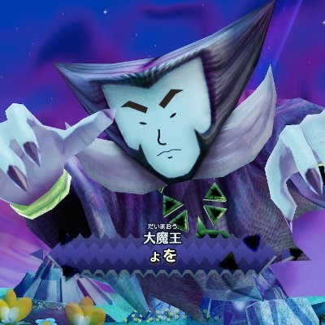
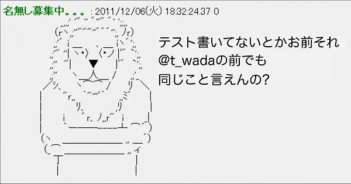

<!-- _class: profile -->
<!-- _paginate: false -->



# id:yohfee

### はてな | Mackerel CRE

ゆる募：炒飯がおいしいお店

---

<!-- _class: title -->
<!-- _paginate: false -->

# ビルドツールを換えたら<br>**2 年越しのバグが爆発**した

Sendai Frontend Meetup × TSKaigi Sendai

---

<!-- _class: impact -->
<!-- _paginate: false -->

※ 副業で引き継いだ Web サービスの話

---

<!-- _class: impact whiteout -->
<!-- _paginate: false -->

## ビルドツールを Webpack + Babel から Vite に換えたら

# とある画面が<br>真っ白に！

---

<!-- _class: quiz -->

## このコード、何がまずい？

```ts
const plans = useMemo(() => {
  const thePlans = myPlanGroup?.plans || []
  if (plans?.length <= 0) return []
  return [...thePlans.sort((a, b) => a.rank - b.rank)]
}, [myPlanGroup])
```

- TypeScript：エラー無し
- ESLint：エラー無し

+ Webpack + Babel：動作する
+ Vite：動作しない

---

<!-- _class: console -->

## ヒント

```ts
const plans = useMemo(() => {
  const thePlans = myPlanGroup?.plans || []
  if (plans?.length <= 0) return []
  return [...thePlans.sort((a, b) => a.rank - b.rank)]
}, [myPlanGroup])
```

> `ReferenceError: Cannot access 'plans' before initialization`

---

<!-- _class: answer -->

## 答え

```ts
const plans = useMemo(() => {
  const thePlans = myPlanGroup?.plans || []
  if (plans?.length <= 0) return [] // 初期化中の自分を参照
  return [...thePlans.sort((a, b) => a.rank - b.rank)]
}, [myPlanGroup])
```

```diff
- if (plans?.length <= 0) return []
+ if (thePlans?.length <= 0) return []
```

---

<!-- _class: aside -->

## ちなみに：もう 1 つのバグ

`sort` は配列をその場で並べ替える → 元の `myPlanGroup.plans` まで並び替わる

```diff
- return [...thePlans.sort((a, b) => a.rank - b.rank)]
+ return [...thePlans].sort((a, b) => a.rank - b.rank)
```

ES2023 以降なら `thePlans.toSorted(...)` でも OK

---

<!-- _class: es5 -->

## なぜこれまでは動いていたのか

Babel 7 の preset-env は targets 指定なし・browserslist なし → **ES5 まで変換**
`const` が `var` になっていた

```js
var plans = useMemo(() => {
  if (plans?.length <= 0) return []
```

`var` は巻き上げられ、代入前でも `undefined` として読める（TDZ が無い）

1. `plans?.length`
2. `undefined <= 0`
3. `false`
4. 次の行へ進む（**偶然正しい**）

---

<!-- _class: console verify -->

## 確かめる

```js
> var p = (() => { if (p?.length <= 0) return []; return ['sorted'] })()
> p
[ 'sorted' ]
```

```js
> const q = (() => { if (q?.length <= 0) return []; return ['sorted'] })()
```

> `Uncaught ReferenceError: Cannot access 'q' before initialization`

---

## なぜ壊れたのか

|  | Webpack + Babel | Vite |
|-|-|-|
| 出力 | ES5（`const` → `var`） | モダンES（`const` のまま） |
| `plans` の参照 | `undefined` が返る | TDZ で `ReferenceError` |
| 結果 | 偶然動く | 爆発！ |

> コードは同じ。変わったのは**実行時の意味**。

---

<!-- _class: cards suspects -->

## なぜ誰も止めなかったのか

- tsc *「関数の中は管轄外なんで」*
  - `strict` でも、関数の中からの参照は「後で呼ばれるかもしれない」ので検査しない
- ESLint *「名前より後ろだったのでセーフです」*
  - @typescript-eslint/no-use-before-define は error 設定
  - それでも、参照が宣言の名前より後ろの位置にあるので通過する
- `?.` *「ちゃんとチェックしてました」*（してない）
  - チェックをしたように見える
  - 「`undefined` でも大丈夫なように書いてある」と読めてしまい、レビューでも見落としやすい

---

<!-- _class: impact missing -->
<!-- _paginate: false -->

## なぜ画面が真っ白になったのか

# `ErrorBoundary` が無い<br>`errorElement` も無い

だから例外 1 つでアプリ全体が消える

---

<!-- _class: cards lessons -->

## 学び

- ビルドツールの移行は「実行時の意味が変わる変更」
  - トランスパイルが言語本来の挙動を隠していることがある
- 型と lint の守備範囲を知っておく
  - クロージャ越しの TDZ は、どちらも見ていない
- `ErrorBoundary` | `errorElement` を保険として置く
  - 1 画面のバグで、アプリ全体を消さない

---

<!-- _class: impact relief -->
<!-- _paginate: false -->

# めでたしめでたし

---

<!-- _class: impact quiet -->
<!-- _paginate: false -->

# 本当に？

---

<!-- _class: impact -->
<!-- _paginate: false -->

# 大事なことを<br>お忘れでは？

---

<!-- _class: impact rant -->
<!-- _paginate: false -->

# なんでコードにテストが無いんだよ...？<br>教えはどうなってんだ 教えは！

---

<!-- _class: punch -->
<!-- _paginate: false -->



- ゴ
- ゴ
- ゴ
- ゴ
- ゴ
- ゴ
- ゴ

---

<!-- _class: cards reasons -->

## とはいえ 11 万行に対してのテストを一気にはムズイ

- 依存だらけのコードでテストしにくい
- 画面のテストは手間のわりに効果が薄い
- 後付けのテストはバグごと固めてしまう

---

<!-- _class: cards lessons -->

## 安くて効くところからやってるのでお許しください

- 純粋なロジック
  - 計算や判定など、入力と出力だけで確かめられるところ
- ロジックを切り出してテスト
  - 大きなクラスを丸ごとではなく、ルールだけを関数にする
- 主要な流れだけ結合テスト・E2E
  - 全部ではなく、壊れたら困るところを数本

---

<!-- _class: finale -->
<!-- _paginate: false -->

# 明日はTDDBCで <br>t-wadaさんと<br>アクス🪓
